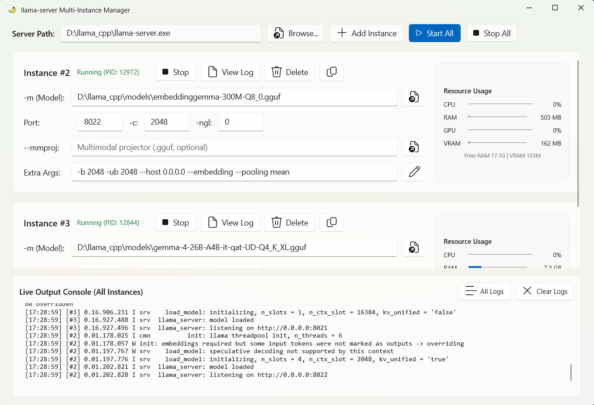

  
  <h1>Llama Starter</h1>

## Intro

A multi-instance launcher for `llama-server.exe`, allowing you to configure different ports and custom startup arguments.

## Download
You can download the latest version from the [Releases](https://github.com/ckcool6/llama_starter/releases) page.

## Screenshots

## Features

- **WinUI 3 GUI wrapper** for `llama-server.exe` (pure wrapper)
- **Built-in .NET Runtime** (no separate runtime installation needed)
- **Minimize to system tray**

## License

This project is licensed under the [MIT License](LICENSE).
